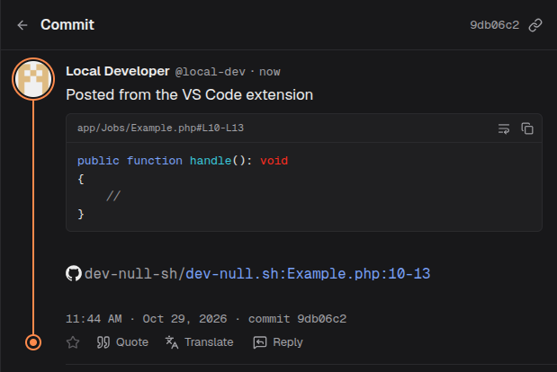

# /dev/null for VS Code

Commit code from your editor to [/dev/null](https://dev-null.sh), the social network for developers.



## Commands

- **Commit Selection to /dev/null**: select lines, right-click, and say something about them. The code goes in a highlighted block titled with its path and lines. When the file is in a GitHub repository and its commit is pushed, a link to the lines on GitHub is added.
- **/dev/null: Commit**: a quick commit from the command palette.
- **/dev/null: Sign In** and **/dev/null: Sign Out**.

## Signing in

The extension signs in like the /dev/null apps do. It makes its own SSH key and opens /dev/null in your browser, where you approve the key as a device. There is no password or token. The key stays in VS Code's secret storage and signs every request. You can revoke it any time under **Settings → Devices** on /dev/null.

Before your first commit from an app, accept the commit rules once in the web composer.

## Settings

- `devnull.url`: the site to commit to, `https://dev-null.sh` by default.
- `devnull.linkToGitHub`: add the GitHub link to selected lines, on by default.

## Development

```sh
npm install
npm test
npm run package
```

This is a community extension, not made by the /dev/null team.
